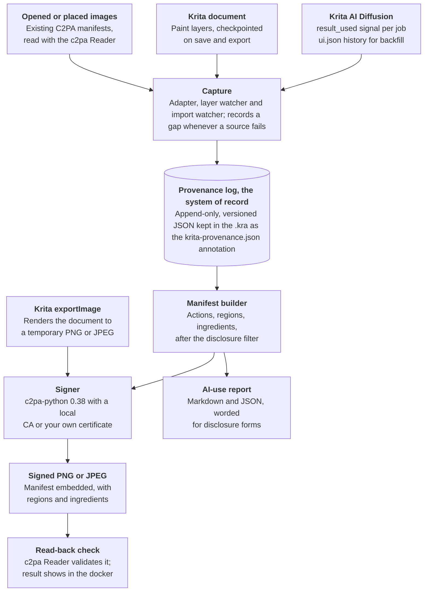
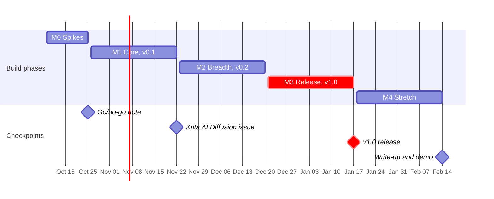

# Krita C2PA Provenance Plugin — Project Spec

Oct 12, 2026 · @Kable

> **Snapshot.** Exported from the project's Claude Doc on 12 Oct 2026 (revision 21) so it can be read in this repo. The text is unchanged except where the owner asked on 18 Oct 2026: the log example shows `read_back`, and Q1 and the finished items under "This week" are ticked. The two diagrams, which the export drops, are redrawn below in Mermaid. Progress is otherwise tracked in [CLAUDE.md](../CLAUDE.md), not here. Live doc (owner only): https://claude.ai/code/artifact/53eb2ecb-ab02-4e17-9c40-1e93e9c4d521

Build an open-source Krita plugin that records each AI generation and layer edit in a document, then exports a signed C2PA manifest. Its users are artists who must disclose AI use; it doubles as a portfolio piece for provenance engineering roles. Spikes run to Oct 25, 2026, v1.0 ships by Jan 17, 2027, and stretch work ends mid-February 2027.

## Goals and non-goals

v1 records what the plugin observed in Krita and signs it; it never claims a work is human-made.

| Goal | Done when |
| --- | --- |
| G1 Capture each Krita AI Diffusion result applied to a document | Every applied result appears once in the log, with model, seed, parameters and region, after save and reopen |
| G2 Record layer-level human edits | New, changed and removed paint layers appear as events with bounds at each checkpoint |
| G3 Export PNG or JPEG with a signed C2PA manifest | Output validates in c2pa-python and c2patool, with an untrusted signer as the only warning |
| G4 Keep Adobe Content Credentials intact | An Adobe-credentialed image used in Krita survives export as an ingredient with its validation status |
| G5 Produce a plain-language AI-use report | The report lists AI regions and human layers in wording usable for disclosure forms |
| G6 State the limits honestly | README, dialogs and report follow the honesty rules in the threat model |

Out of scope for v1:

- Proving human authorship or detecting AI in pixels.
- C2PA trust-list membership, a certificate authority or verified identity.
- Stroke-level or pen-input logging.
- Changes to Krita itself; Android; animation documents.
- The krita-artists.org plugin section.
- Legal advice: the report states facts, not conclusions.

## Users and use cases

The first users are Krita AI Diffusion users who must disclose AI use; reviewers and recruiters are the second audience.

| User | Need | Acceptance check |
| --- | --- | --- |
| Illustrator registering a US copyright | Separate AI-generated material from their own authorship | Report names each AI region and each human layer, ready for the application's disclosure fields |
| Indie developer selling on Steam | Describe AI use per asset | Report gives a one-paragraph summary per exported file |
| Etsy or Kickstarter creator | Disclose AI use in a listing or campaign | Same summary, plus a manifest a buyer can inspect |
| Artist combining Firefly or Photoshop output with Krita work | Keep the incoming Content Credentials chain | Export lists the source as an ingredient with its status |
| Krita AI Diffusion maintainer | A signed-metadata layer for Interstice.cloud results | Optional signing path offered upstream (Phase B) |
| Reviewer or recruiter | See C2PA depth fast | A three-minute demo and a design write-up |

Why these needs are real:

- The Copyright Office asks applicants to disclose more-than-de-minimis AI-generated material and briefly explain the human contribution ([USCO letter, Feb 2024](https://www.copyright.gov/laws/hearings/USCO-Letter-on-AI-and-Copyright-Initiative-Update.pdf)).
- Krita AI Diffusion 1.53.0 tags cloud results and watermarks them for EU users; local generation gets neither ([release notes](https://github.com/Acly/krita-ai-diffusion/releases/tag/v1.53.0)).
- The EU's final Code of Practice (10 June 2026) asks providers for at least two layers of machine-readable marking, such as metadata plus a watermark ([Jones Day](https://www.jonesday.com/en/insights/2026/06/european-commission-publishes-final-code-of-practice-on-marking-and-labelling-aigenerated-content)).

## Requirements

The MVP is capture plus signed export; later items extend it without changing the log format.

| ID | Requirement | Release |
| --- | --- | --- |
| C1 | Listen to Krita AI Diffusion's per-document `result_used` signal and copy the job's params then; its job history is pruned by memory size | MVP |
| C2 | Identify the layer that received the result by diffing node unique IDs around the apply | MVP |
| C3 | Record capture gaps: plugin off, adapter error, Krita AI Diffusion missing | MVP |
| C4 | Backfill from Krita AI Diffusion's `ui.json` history on open, marked as recovered | v1.0 |
| C5 | Checkpoint paint layers on save and export: unique ID, name, bounds, content hash | v1.0 |
| C6 | Record opened and placed images, reading any C2PA manifest they carry | v1.0 |
| C7 | Capture live painting, upscaling and control-layer jobs | Later |
| P1 | Store the log as versioned JSON in a document annotation, written debounced and before save | MVP |
| P2 | Store incoming ingredient manifests in their own annotations | v1.0 |
| P3 | Migrate older log versions on load | v1.0 |
| E1 | "Export with Content Credentials" action: Krita `exportImage` to a temp file, then build, sign and write | MVP |
| E2 | PNG and JPEG output | MVP |
| E3 | WebP output | Later |
| E4 | Read the output back with the SDK and show the validation result | MVP |
| E5 | Never add custom hash exclusions | MVP |
| E6 | If signing fails, save the file labelled unsigned; never produce a file that looks signed | MVP |
| D1 | Scrub file paths, user names and machine names from every field | MVP |
| D2 | Three disclosure levels: full, standard (default), minimal | v1.0 |
| D3 | Salted SHA-256 commitments in place of prompts at standard level | v1.0 |
| D4 | Preview exactly what the manifest will say before export | v1.0 |
| D5 | Optional "do not train" assertion (c2pa-python ships an example) | Later |
| R1 | AI-use report (Markdown and JSON) beside each export | v1.0 |
| R2 | Report shows each AI region's share of the canvas and lists human layers | v1.0 |
| R3 | Report says it is not legal advice and that the user judges what is de minimis | v1.0 |
| V1 | Docker showing the document's log as a timeline | MVP |
| V2 | "Inspect file" for any image: status, actions, ingredients, region overlay | v1.0 |
| V3 | Plain-language validation messages, such as "Unrecognized signer" | v1.0 |
| V4 | Check imported images for a TrustMark watermark and compare it with their manifest | Later |
| K1 | First run creates a local root CA and an end-entity signing certificate, and shows its fingerprint | MVP |
| K2 | Bring-your-own certificate chain and key (PEM) | v1.0 |
| K3 | Optional RFC 3161 timestamp authority | v1.0 |
| K4 | Key passphrase and rotation | Later |
| I1 | Zip installs via Tools ▸ Scripts ▸ Import Python Plugin from File | MVP |
| I2 | First run fetches the platform's c2pa-python wheel, pinned to 0.38.x and hash-checked | MVP |
| I3 | One code path for PyQt5 (Krita 5) and PyQt6 (Krita 6) | v1.0 |
| I4 | Offline install from a local wheel file | v1.0 |

ID prefixes: C capture, P persistence, E export, D disclosure, R report, V inspect, K keys, I install.

## Architecture

**Every source feeds one log; the C2PA manifest is built only at export.**



Capture never writes C2PA directly. The manifest is rebuilt from the log at each export, so mapping fixes also apply to older documents.

## Provenance log

The log is the system of record: an append-only event list stored as JSON in the .kra, separate from C2PA so the mapping can change without losing history.

```json
{
  "schema": "krita-provenance/1",
  "document_id": "4b0e2f1c-…",
  "log_started": {"at": "2026-11-02T18:04:11Z", "reason": "new_document"},
  "events": [
    {
      "type": "generation_applied",
      "at": "2026-11-02T18:20:45Z",
      "source": {"tool": "krita-ai-diffusion", "version": "1.53.0", "backend": "local"},
      "job": {"id": "…", "kind": "diffusion", "workflow_kind": "inpaint", "result_index": 2,
              "bounds": [512, 128, 768, 640], "has_mask": true, "seed": 1234567},
      "model": {"checkpoint": "…", "style": "…", "sampler": "…", "steps": 24,
                "guidance": 4.5, "strength": 0.65},
      "prompt": {"text": "…", "negative": "…"},
      "target_layer": {"uuid": "{…}", "name": "…"}
    },
    {"type": "layer_changed", "at": "…", "layer": {"uuid": "{…}", "name": "Lineart"},
     "bounds": [0, 0, 2048, 2048], "hash": "sha256:…"},
    {"type": "ingredient_added", "at": "…", "relationship": "componentOf",
     "title": "background.png", "store": "krita-provenance/ingredient-1", "validation": "valid"},
    {"type": "capture_gap", "from": "…", "to": "…", "reason": "adapter_error"},
    {"type": "exported", "at": "…", "format": "png", "disclosure": "standard",
     "manifest_label": "urn:c2pa:…",
     "read_back": {"state": "Valid", "failures": ["signingCredential.untrusted"]}}
  ]
}
```

- `job` and `model` mirror Krita AI Diffusion's `JobParams`: bounds, seed, has\_mask, workflow\_kind, plus the metadata keys prompt, negative\_prompt, strength, style, checkpoint, sampler, steps and guidance ([jobs.py](https://github.com/Acly/krita-ai-diffusion/blob/main/ai_diffusion/model/jobs.py)).
- LoRAs are not in `JobParams.metadata`; read them from the style at capture time (spike S3).
- The annotation is named `krita-provenance.json`. Krita AI Diffusion uses `ui.json` and `result{n}.webp` ([persistence.py](https://github.com/Acly/krita-ai-diffusion/blob/main/ai_diffusion/persistence.py)), so names don't clash.
- Krita's Document API provides `annotation`, `setAnnotation`, `annotationTypes` and `removeAnnotation` for this ([Document API](https://api.kde.org/krita/html/classDocument.html)).
- Full prompts stay in the .kra; the disclosure level decides what leaves it.
- `read_back` keeps what reading a signed export back reported (E4): the SDK's validation state and failure codes. An unsigned export has none. It stays in the log and isn't written into manifests.

## C2PA mapping

Each log event becomes one C2PA action; regions go in the action's `changes`, and the first action is always `c2pa.created` or `c2pa.opened`.

| Log event | C2PA action | Digital source type | Region (`changes`) | Ingredient |
| --- | --- | --- | --- | --- |
| Document created in Krita, logged from the start | `c2pa.created`, first (Builder intent Create) | `empty`: a blank canvas | — | — |
| Document opened from an image file | `c2pa.opened`, first (Builder intent Edit) | From the source manifest, if any | — | `parentOf` |
| Generation applied, layer visible at export | `c2pa.edited` (Q1) | `compositeWithTrainedAlgorithmicMedia` | Rectangle = job bounds, role `c2pa.edited` | Reference images and prompt as `inputTo`, off by default (Q9) |
| Generation applied, layer later merged or hidden | `c2pa.edited`, described as merged or hidden | `compositeWithTrainedAlgorithmicMedia` | Rectangle = job bounds | — |
| Paint layer changed between checkpoints | `c2pa.drawing` | — | Rectangle = changed bounds | — |
| Image placed or file layer added | `c2pa.placed` | From the ingredient's manifest, if any | Rectangle = layer bounds, role `c2pa.placed` | `componentOf` |
| Export from .kra to PNG or JPEG | `c2pa.converted` | — | — | — |
| Capture gap | `c2pa.unknown`, with the gap in its description | — | Left out on purpose | — |

- The first action must be `c2pa.created` or `c2pa.opened`; an action tied to an ingredient lists its `instance_id` in `parameters.ingredientIds` ([CAI docs](https://opensource.contentauthenticity.org/docs/manifest/writing/assertions-actions)).
- c2pa-rs Builder intents enforce this: Create requires a source type, and Edit requires a parent ingredient ([builder.rs](https://github.com/contentauth/c2pa-rs/blob/58b9a092882b4dcbdbfe854073a1021d3fcbf9a9/sdk/src/builder.rs)).
- c2pa-rs defines `compositeWithTrainedAlgorithmicMedia` as generative-AI augmentation, such as inpainting or outpainting, which matches Krita AI Diffusion's edits. `trainedAlgorithmicMedia` means media made wholly by a model ([actions.rs](https://github.com/contentauth/c2pa-rs/blob/58b9a092882b4dcbdbfe854073a1021d3fcbf9a9/sdk/src/assertions/actions.rs)).
- The same file defines `empty` as a blank canvas, `c2pa.drawing` as brush or eraser changes, `c2pa.converted` as a format change, and `c2pa.unknown` as an action the generator cannot specify.
- An action with no `changes` reads as "anything may have changed", so a capture gap leaves it out on purpose.
- Regions use `spatial` ranges with `rectangle`, `circle` or `polygon` shapes in `pixel` or `percent` units ([region\_of\_interest.rs](https://github.com/contentauth/c2pa-rs/blob/58b9a092882b4dcbdbfe854073a1021d3fcbf9a9/sdk/src/assertions/region_of_interest.rs)).
- Ingredients relate as `parentOf`, `componentOf` or `inputTo` ([ingredient.rs](https://github.com/contentauth/c2pa-rs/blob/58b9a092882b4dcbdbfe854073a1021d3fcbf9a9/sdk/src/assertions/ingredient.rs)). C2PA's AI/ML guidance allows the prompt itself as an `inputTo` ingredient ([guidance](https://spec.c2pa.org/specifications/specifications/2.3/ai-ml/ai_ml.html)).
- Spec 2.4 adds a `c2pa.ai-disclosure` assertion ([spec 2.4](https://spec.c2pa.org/specifications/specifications/2.4/specs/C2PA_Specification.html)), but c2pa-rs's main branch has no support for it as of 6 Oct 2026 (Q11).

Illustrative manifest definition. Action, source-type and region names are checked against c2pa-rs; parameter keys are still to be settled in spike S5:

```json
{
  "claim_generator_info": [{"name": "krita-provenance", "version": "0.1.0"}],
  "title": "harbour.png",
  "assertions": [{
    "label": "c2pa.actions.v2",
    "data": {"actions": [
      {"action": "c2pa.created",
       "digitalSourceType": "http://c2pa.org/digitalsourcetype/empty",
       "softwareAgent": {"name": "Krita", "version": "5.3"},
       "when": "2026-11-02T18:04:11Z"},
      {"action": "c2pa.edited",
       "digitalSourceType": "http://cv.iptc.org/newscodes/digitalsourcetype/compositeWithTrainedAlgorithmicMedia",
       "softwareAgent": {"name": "Krita AI Diffusion", "version": "1.53.0"},
       "when": "2026-11-02T18:20:45Z",
       "parameters": {"model": "…", "seed": 1234567, "steps": 24, "strength": 0.65,
                      "prompt_commitment": "sha256:…"},
       "changes": [{
         "region": [{"type": "spatial",
                     "shape": {"type": "rectangle", "unit": "pixel",
                               "origin": {"x": 512, "y": 128}, "width": 768, "height": 640}}],
         "role": "c2pa.edited",
         "description": "Inpainted region on layer Sky"}]},
      {"action": "c2pa.drawing",
       "softwareAgent": {"name": "Krita", "version": "5.3"},
       "changes": [{
         "region": [{"type": "spatial",
                     "shape": {"type": "rectangle", "unit": "pixel",
                               "origin": {"x": 0, "y": 0}, "width": 2048, "height": 2048}}],
         "description": "Layer Lineart changed"}]},
      {"action": "c2pa.converted",
       "softwareAgent": {"name": "krita-provenance", "version": "0.1.0"},
       "description": "Exported from .kra to PNG"}
    ]}
  }]
}
```

## Krita AI Diffusion integration

Phase A reads Krita AI Diffusion's internals with no upstream change; Phase B proposes a small, stable hook once the M1 prototype works.

Phase A, read-only adapter (M0 to M1):

1. Find the per-document model inside the `ai_diffusion` package; spike S3 confirms the accessor. If it isn't found, record a capture gap and carry on.
2. Connect to the job queue's `result_used` signal, which carries a job id and result index. Look the job up with `jobs.find(id)` and copy its `params` at once ([jobs.py](https://github.com/Acly/krita-ai-diffusion/blob/main/ai_diffusion/model/jobs.py)).
3. Find the receiving layer by diffing node unique IDs before and after the apply. New layers are named from `JobParams.name`, so names aren't unique.
4. On open, backfill from `ui.json`: `history[].params` plus the `in_use` flags. Treat it as partial, because stored history is pruned by size ([persistence.py](https://github.com/Acly/krita-ai-diffusion/blob/main/ai_diffusion/persistence.py)).
5. Pin the tested Krita AI Diffusion versions. On any other version, warn, keep capturing, and log a gap if a call fails.

Phase B, upstream (after the M1 demo):

- Open an issue first, as the contributing guide asks for bigger changes ([CONTRIBUTING](https://github.com/Acly/krita-ai-diffusion/blob/main/CONTRIBUTING.md)).
- Propose one documented signal or callback carrying the applied job's params and the target layer IDs.
- Separately, offer optional C2PA signing for Interstice.cloud results, beside its existing tag and EU watermark.
- Mind the Qt split: the main branch imports PyQt6, while the 1.53.0 release targets Krita 5 ([release notes](https://github.com/Acly/krita-ai-diffusion/releases/tag/v1.53.0)).

v1 captures `diffusion` jobs only; `upscaling`, `live_preview`, `control_layer` and animation jobs come later (C7).

## Threat model and honesty rules

A manifest from this plugin states what software on the signer's machine observed; it proves nothing about what happened elsewhere.

| The manifest shows | It does not show |
| --- | --- |
| Which generations the plugin saw applied, with parameters and regions | That no other AI was used, outside Krita or before import |
| Which layers changed between checkpoints | Who the signer is: local certificates show as unrecognized in Adobe's tools ([CAI docs](https://opensource.contentauthenticity.org/docs/signing/local-signing/)) |
| That the file hasn't changed since signing | That the log wasn't edited before signing, since the signer controls both |

| Threat | Handling |
| --- | --- |
| Log edited before export | Out of scope by design; stated in the README |
| AI output laundered by painting over, screenshotting or importing it as a plain image | Cannot be prevented; the plugin never claims no AI was used |
| Manifest stripped on upload | The report travels separately; TrustMark soft binding is a stretch goal |
| Hash-exclusion abuse, as demonstrated in October 2026 | The signer adds no custom exclusions; the inspector flags unusual ones |
| Stolen signing key | Restrictive file permissions, optional passphrase, rotation |
| Malicious manifest in an imported file | Parse only through the SDK, cap sizes, show text as plain text |
| Prompt, path or name leakage | Standard disclosure by default, commitments, path scrubbing, preview |
| Tampered dependency | Pinned c2pa-python version and SHA-256 |

Honesty rules, enforced in code and tests:

1. Never write "no AI used". Absence reads: "No AI generation observed by this plugin since" plus the log's start date.
2. Record every capture gap and disclose it in the manifest and the report.
3. When attribution is uncertain, such as after a layer merge, disclose the region as possibly AI and say why.
4. The report states facts, not legal conclusions.

## Testing and validation

Every export must validate in two independent readers, and the C2PA mapping is tested outside Krita.

- Unit tests (pytest, no Krita): mapping, disclosure filter, report, schema migrations, and `ui.json` parsing from real .kra fixtures.
- Golden manifests: fixture logs map to expected manifest JSON, are signed with a test certificate and read back. The only allowed warning is an untrusted signer.
- Cross-tool: c2patool and Adobe's Verify or Inspect on every release. Local certificates should show the "issuer couldn't be recognized" notice ([CAI docs](https://opensource.contentauthenticity.org/docs/signing/local-signing/)).
- Interop fixtures: a Firefly image, a Photoshop Generative Fill export, and the C2PA public test files.
- In-Krita smoke checklist per release. Krita AI Diffusion's own guide notes that code using Krita's API isn't unit-tested ([CONTRIBUTING](https://github.com/Acly/krita-ai-diffusion/blob/main/CONTRIBUTING.md)).
- Matrix: Windows x64, macOS arm64 and Linux x64, against Krita 5.3 (plus 6, if Q7 says so) and the two newest Krita AI Diffusion releases.
- Benchmarks: export overhead at 2K, 4K and 8K; target under 3 seconds at 4K, confirmed in M1.
- Security: malformed manifests, oversized annotations and hash-exclusion test files.
- Tooling mirrors Krita AI Diffusion: ruff, pyright with Krita stubs, CI on every push.

## Distribution and outreach

Ship through GitHub and Krita AI Diffusion's channels, not the krita-artists.org plugin section, which bars AI-integrated and AI-written plugins.

- Package: a zip installed via Tools ▸ Scripts ▸ Import Python Plugin from File, the same route Krita AI Diffusion uses.
- Dependency: the c2pa-python 0.38.0 wheel, downloaded on first run. The Windows x64 wheel is about 88 MB; macOS and Linux wheels are about 15 MB ([PyPI](https://pypi.org/project/c2pa-python/)).
- Licence: GPL-3.0-or-later proposed, matching the Krita ecosystem; c2pa-python is MIT or Apache-2.0. Confirm Krita AI Diffusion's licence before importing its modules (Q6).
- Name: working title krita-provenance. Check C2PA's brand terms before using "Content Credentials" or the CR icon in the UI.
- Releases: GitHub Releases with artifact attestations, so the provenance tool has provenance of its own.
- AI assistance: disclosed in the README and in commit trailers. Check each upstream project's contribution policy before opening a PR.
- Outreach order: a Krita AI Diffusion issue at the end of M1, a Discussions post with the demo in M3, then the people in issues #660 and #2012, then a write-up. Check r/StableDiffusion's rules before posting there.

## Milestones

**v1.0 lands after 14 weeks; stretch work runs four more.**



M1 to M3 run four weeks each. The holidays fall inside M3, so its end date is the one most likely to slip.

| Milestone | Scope | Exit gate |
| --- | --- | --- |
| M0 Spikes | S1 to S5 from This week | Go/no-go note; each spike passes or has a written workaround |
| M1 Core, v0.1 | C1 to C3, P1, E1, E2, E4 to E6, D1, V1, K1, I1, I2 | Exports validate in c2pa-python and c2patool; Adobe's Verify shows the actions; Krita AI Diffusion issue opened with a demo |
| M2 Breadth, v0.2 | C4 to C6, P2, D2 to D4, R1 to R3, V2, V3, K2, K3, I3 | An Adobe-credentialed image keeps its chain through export; the report covers two real disclosure forms |
| M3 Release, v1.0 | P3, I4, packaging, docs, test matrix, threat model, demo video | Matrix passes; v1.0 tagged; Discussions post live |
| M4 Stretch | V4 TrustMark check, TypeScript region viewer, upstream PRs, write-up | Write-up and demo published; other Later items stay in the backlog |

| Success metric | Target | Checked at |
| --- | --- | --- |
| Exports validating in both readers, with an untrusted signer as the only warning | All of the test matrix | M1 gate |
| Export overhead at 4K | Under 3 seconds | M1 gate |
| Issues or discussions opened by people you don't know | 3 or more | 6 weeks after v1.0 |
| GitHub release downloads | 100 or more | 6 weeks after v1.0 |
| Upstream engagement | Issue answered; one merged PR as a stretch | M4 gate |

The adoption targets are guesses; revisit them at the M3 gate.

## Risks

The biggest risk is Krita AI Diffusion changing its internals; the version-checked adapter and an upstream hook are the answer.

| Risk | Likelihood | Impact | Mitigation |
| --- | --- | --- | --- |
| Krita AI Diffusion internals change and break capture | High | High | Version-checked adapter, tests per release, upstream hook proposal |
| Maintainer declines a hook | Medium | Medium | Plugin keeps working standalone through the adapter |
| c2pa-python API churn: 13 releases between 17 July and 29 September 2026 | High | Medium | Pin 0.38.x, wrap the SDK in one module, upgrade on purpose |
| SDK rejects the locally generated certificate | Medium | High | Spike S2; fall back to SDK test certificates for demos, plus bring-your-own |
| Human-edit records stay coarse, since Krita's API has no per-stroke events | High | Medium | Checkpoint diffs; state the granularity in the README |
| AI pixels move into "human" layers through merges or copies | High | Medium | Conservative attribution (honesty rule 3) |
| Prompt, path or name leaks | Medium | High | Standard disclosure by default, commitments, scrubbing, preview |
| Large Windows wheel (about 88 MB) slows first run | High | Low | Download with progress; offline wheel option |
| PyQt5 and PyQt6 split across Krita 5 and 6 | Medium | Medium | Compatibility shim from day one |
| Source-type choices display oddly in Adobe's tools | Medium | Medium | Mirror Adobe reference files (S5); ask in contentauth discussions |
| Backlash in general Krita spaces | Medium | Low | Stay in GitHub and Krita AI Diffusion channels; disclose AI assistance |
| Stretch items crowd out v1.0 | High | Medium | Stretch work only in M4 |

## Open questions

Nine decisions remain open and should close before M2 starts. Q1 and Q2 are settled.

- [x] Q1 Settled by spike S5 (18 Oct 2026): keep `c2pa.edited` with `compositeWithTrainedAlgorithmicMedia` alone, as Adobe Firefly records its Generative Fill and prompt edits; no `componentOf` ingredient per result.
- [x] Q2 Settled from c2pa-rs: `c2pa.drawing` covers brush and eraser changes, and `empty` marks a blank canvas.
- [ ] Q3 Default disclosure level: standard (proposed) or minimal?
- [ ] Q4 Timestamps: on by default for longer-lived signatures, or off to avoid a network call?
- [ ] Q5 Key storage: the plugin's data folder with file permissions, or the OS keychain?
- [ ] Q6 Licence: GPL-3.0-or-later, pending a check of Krita AI Diffusion's licence.
- [ ] Q7 Krita 6 support in v1.0 or v1.1?
- [ ] Q8 Model identity: hash checkpoints locally (slow, cached) or record names only?
- [ ] Q9 Reference images and prompts: record them as `inputTo` ingredients, as C2PA's AI/ML guidance allows, off by default?
- [ ] Q10 Does applying a live-painting result fire `result_used`? (S3)
- [ ] Q11 AI disclosure: write spec 2.4's `c2pa.ai-disclosure` as a custom assertion, or contribute support to c2pa-rs first?

## This week

This week sets up the toolchain and starts the five spikes; the go/no-go note is due Oct 25, 2026.

- [x] Install Krita 5.3 and Krita AI Diffusion 1.53.0 with the local managed server.
- [x] Create the repo: plugin package and `.desktop` file, ruff, pyright with Krita stubs (Krita AI Diffusion keeps its stubs in `scripts/typeshed`), pytest and CI.
- [x] In a virtualenv, install c2pa-python 0.38.0, run its `sign.py` and `read.py` examples, and install c2patool.
- [ ] S1: load c2pa-python inside Krita on each OS, confirm the embedded Python is 3.10 or newer, and sign a PNG from the Scripter.
- [x] S2: generate a local root CA and an end-entity certificate the SDK accepts; check that Adobe's Verify shows "Unrecognized".
- [x] S3: from a separate plugin, catch `result_used`, copy the job's `params` and identify the target layer.
- [x] S4: write and read a custom annotation; confirm it survives save and reopen beside `ui.json`.
- [x] S5: dump a Firefly image and a Photoshop Generative Fill export with c2patool; decide Q1.
- [x] Write the go/no-go note.

## Sources

- [Krita AI Diffusion v1.53.0 release notes](https://github.com/Acly/krita-ai-diffusion/releases/tag/v1.53.0)
- [Krita AI Diffusion CONTRIBUTING.md](https://github.com/Acly/krita-ai-diffusion/blob/main/CONTRIBUTING.md)
- [Krita AI Diffusion persistence.py](https://github.com/Acly/krita-ai-diffusion/blob/main/ai_diffusion/persistence.py)
- [Krita AI Diffusion model/jobs.py](https://github.com/Acly/krita-ai-diffusion/blob/main/ai_diffusion/model/jobs.py)
- [Krita Document class API](https://api.kde.org/krita/html/classDocument.html)
- [c2pa-python on PyPI](https://pypi.org/project/c2pa-python/)
- [c2pa-rs actions.rs, main as of 6 Oct 2026](https://github.com/contentauth/c2pa-rs/blob/58b9a092882b4dcbdbfe854073a1021d3fcbf9a9/sdk/src/assertions/actions.rs)
- [c2pa-rs region\_of\_interest.rs](https://github.com/contentauth/c2pa-rs/blob/58b9a092882b4dcbdbfe854073a1021d3fcbf9a9/sdk/src/assertions/region_of_interest.rs)
- [c2pa-rs ingredient.rs](https://github.com/contentauth/c2pa-rs/blob/58b9a092882b4dcbdbfe854073a1021d3fcbf9a9/sdk/src/assertions/ingredient.rs)
- [c2pa-rs builder.rs (Builder intents)](https://github.com/contentauth/c2pa-rs/blob/58b9a092882b4dcbdbfe854073a1021d3fcbf9a9/sdk/src/builder.rs)
- [C2PA specification 2.4, version history](https://spec.c2pa.org/specifications/specifications/2.4/specs/C2PA_Specification.html)
- [C2PA guidance for AI/ML (2.3)](https://spec.c2pa.org/specifications/specifications/2.3/ai-ml/ai_ml.html)
- [CAI: Writing assertions and actions](https://opensource.contentauthenticity.org/docs/manifest/writing/assertions-actions)
- [CAI: Signing with local credentials](https://opensource.contentauthenticity.org/docs/signing/local-signing/)
- [IPTC Metawatch: digital source types](https://metawatch.iptc.org/dst/)
- [Adobe TrustMark FAQ](https://raw.githubusercontent.com/adobe/trustmark/main/FAQ.md)
- [Jones Day on the EU Code of Practice (June 2026)](https://www.jonesday.com/en/insights/2026/06/european-commission-publishes-final-code-of-practice-on-marking-and-labelling-aigenerated-content)
- [US Copyright Office letter on its AI initiative (Feb 2024)](https://www.copyright.gov/laws/hearings/USCO-Letter-on-AI-and-Copyright-Initiative-Update.pdf)
